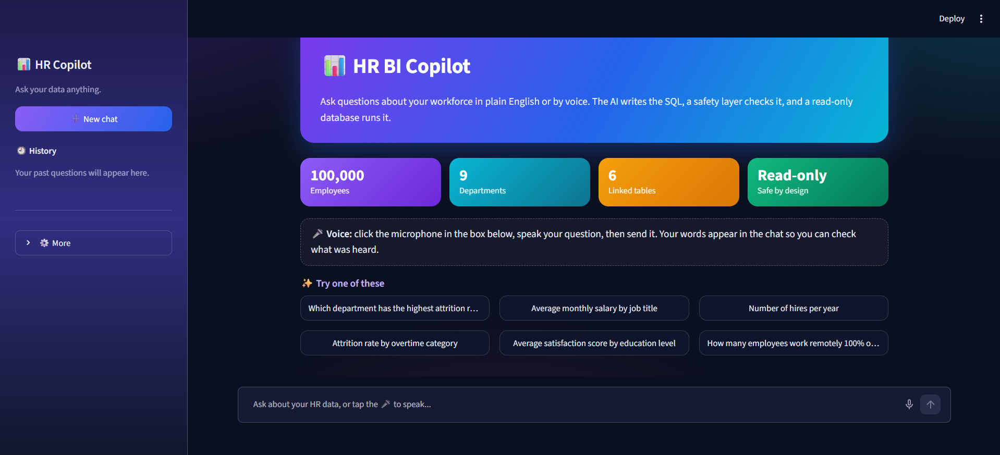
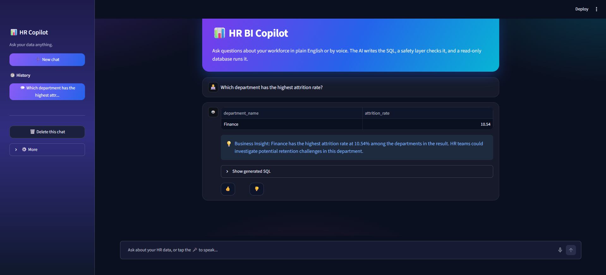
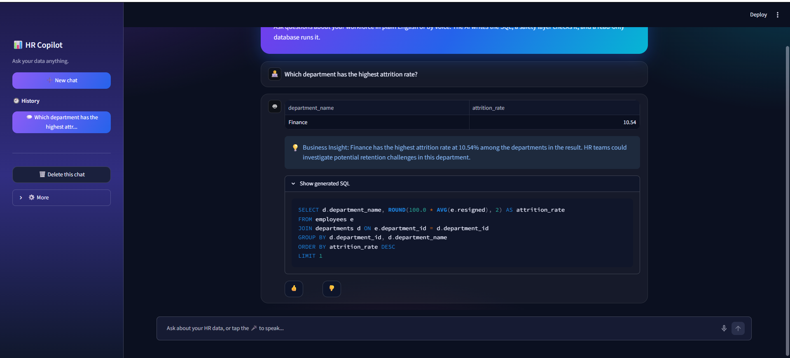

# HR BI Copilot

### AI-Powered HR Analytics | Natural Language to SQL | Interactive Business Intelligence

HR BI Copilot is an AI-powered business intelligence application that allows users to ask HR-related questions in natural language and receive SQL-generated answers, interactive visualizations, and business insights.

The project demonstrates how large language models can make structured business data more accessible while using SQL validation and read-only database access to reduce execution risks.

**Project status:** Core application developed and locally tested. Public deployment is not yet available.

## Business Problem

HR teams frequently need answers to questions such as:

- Which department has the highest attrition rate?
- What is the average salary by job title?
- How has employee hiring changed over time?
- Which departments have the highest employee turnover?

Traditionally, answering these questions may require SQL knowledge or assistance from a data analyst.

HR BI Copilot provides a conversational interface for exploring HR data without requiring users to write SQL manually.

## Key Features

- **Natural Language to SQL:** Converts business questions into SQL queries using an AI model.
- **SQL Safety Validation:** Uses SQLGlot and additional safeguards to restrict unsafe database operations.
- **Read-Only Database Execution:** Executes approved queries against SQLite.
- **Interactive Analytics:** Displays query results in tables and Plotly charts.
- **Business Insights:** Generates rule-based summaries for supported HR analysis patterns.
- **Voice Input:** Supports spoken questions through the application interface.
- **Chat History:** Maintains conversation history within the active Streamlit session.
- **User Feedback:** Allows users to provide positive or negative feedback on responses.
- **Error Handling:** Supports query correction attempts when SQL generation or execution fails.

## Technology Stack

| Component | Technology |
|---|---|
| Programming language | Python |
| Application framework | Streamlit |
| Database | SQLite |
| Data processing | Pandas |
| Data visualization | Plotly |
| AI integration | OpenAI-compatible API client |
| SQL parsing and validation | SQLGlot |
| Environment configuration | python-dotenv |
| Version control | Git and GitHub |

## System Architecture

```text
                  USER
                   |
          Natural Language Question
                   |
                   v
          Streamlit Application
                   |
                   v
             AI SQL Generator
                   |
                   v
              SQL Validator
                   |
             Safe SQL Query?
                /       \
              No         Yes
              |           |
          Reject or       v
           Retry      Read-Only SQLite
                          |
                          v
                    Query Results
                          |
                          v
                 Pandas DataFrame
                          |
                          v
                Charts and Insights
                          |
                          v
                    User Interface
```

## Database Design

The local project uses a relational SQLite database containing 100,000 employee records, organized into six tables:

| Table | Description |
|---|---|
| employees | Employee details, hiring information, resignation status |
| departments | Department identifiers and names |
| jobs | Job titles and identifiers |
| compensation | Salary and promotion information |
| performance | Performance, training, and satisfaction metrics |
| work_patterns | Working hours, overtime, sick days, and remote work |

The database is created using `scripts/build_db.py`.

**Dataset note:** The original dataset and generated SQLite database are not distributed in this repository while source and redistribution permissions remain unverified.

## Evaluation Results

The application was evaluated locally using a predefined set of benchmark questions.

| Evaluation category | Passed | Total |
|---|---:|---:|
| Easy | 10 | 10 |
| Medium | 14 | 14 |
| Hard | 18 | 18 |
| Unsafe requests | 6 | 6 |
| **Total** | **48** | **48** |

**Benchmark pass rate: 100% (48/48)**

A separate set of SQL security tests also passed **7/7 checks**.

These results describe performance on the tested cases only. They do not guarantee correct answers or complete protection against all possible inputs.

## Example Questions

Users can ask questions such as:

- Which department has the highest attrition rate?
- What is the average monthly salary by job title?
- How many employees were hired each year?
- How many employees have resigned?
- Which departments have the largest workforce?

The application generates SQL, validates it, executes approved queries, and displays the results.

## Running Locally

### 1. Clone the repository

```bash
git clone https://github.com/Harineyeddula19/bi-copilot.git
cd bi-copilot
```

### 2. Create a virtual environment

```bash
python -m venv venv
```

On Windows PowerShell:

```powershell
.\venv\Scripts\Activate.ps1
```

### 3. Install dependencies

```bash
pip install -r requirements.txt
```

### 4. Configure environment variables

Create a `.env` file in the project root:

```env
LLM_BASE_URL=your_provider_endpoint
LLM_API_KEY=your_api_key
LLM_MODEL=your_model_name
```

Never commit API credentials to GitHub.

### 5. Prepare the database

Place a legally usable, schema-compatible HR dataset at:

```text
data/HR_Analytics_Cleaned.xlsx
```

Then run:

```bash
python scripts/build_db.py
```

The current database-building script expects a specific worksheet and column structure. An arbitrary HR spreadsheet will not work without adaptation.

### 6. Launch the application

```bash
streamlit run app.py
```

Open the local URL displayed in the terminal.
## Application Screenshots

### 1. HR BI Copilot Dashboard



### 2. Employee Attrition Analysis



### 3. AI-Generated SQL Query



---

## Project Limitations

- SQL generation depends on the configured AI provider and model.
- Generated SQL may occasionally be incorrect or require retries.
- The current business insight generator uses predefined analysis patterns rather than a general-purpose AI narrative model.
- The benchmark dataset is limited and does not represent every possible HR question.
- Public deployment requires a redistributable dataset and secure API configuration.
- The original HR dataset is not included in the public repository.

## Future Improvements

- Deploy an interactive public demo using synthetic HR data.
- Expand automated evaluation with additional unseen questions.
- Add more general-purpose business insight generation.
- Improve query performance monitoring.
- Add broader automated integration and security testing.

## Project Purpose

This project was developed as a practical portfolio demonstration of AI-assisted analytics, SQL, database design, data visualization, and application development.

It focuses on a real business analytics workflow: converting HR questions into validated SQL queries and presenting the results in an accessible interface.